<h3><code>mak@github ~ $ ./contributions.sh</code></h3>

  

<h3><code>mak@github ~ $ whoami</code></h3>
<table>
  <tr>
    <td valign="top"></td>
    <td valign="top"></td>
  </tr>
</table>

<h2>Selected work</h2>

- [Skin Burn](https://github.com/MAK030504/Skin_Burn_Fyp) — burn-wound severity and recovery, GIKI computer engineering final-year project
- [Vivado MCP](https://github.com/MAK030504/vivado-mcp) — MCP server for AMD Vivado
- [EcoSense](https://github.com/MAK030504/ECO_SENSE) — campus environment monitor
- [HackMate](https://github.com/MAK030504/HackMate) — hackathon teammate matching
- [ChainSplit](https://github.com/MAK030504/ChainSplit) — shared expenses on Avalanche Fuji
- [Parkinson TinyML](https://github.com/MAK030504/Parkinson-TinyML) — keystroke model on the PhysioNet MIT-CS2PD set

<h2>Also</h2>

- [Microsoft Club GIKI](https://github.com/Microsoft-Club/Microsoft_Club_Website)

<!--
This README is the GitHub profile page. GitHub renders it only from a public
repository named MAK030504 owned by MAK030504.

Regenerate the art from the repo root:

    pip install -r scripts/requirements.txt
    python scripts/fetch_contributions.py
    python scripts/render_heatmap_svg.py
    python scripts/make_info_card.py
    python scripts/make_ascii_svg.py

The monogram is the stand-in because the GitHub avatar is an identicon.
To use a photo instead:

    pip install -r scripts/requirements-portrait.txt
    python scripts/prep_photo.py source-photo.jpg
    python scripts/make_ascii_svg.py

A daily Actions workflow refreshes the heatmap. The portrait and the card
stay as they are until you regenerate them.
-->
